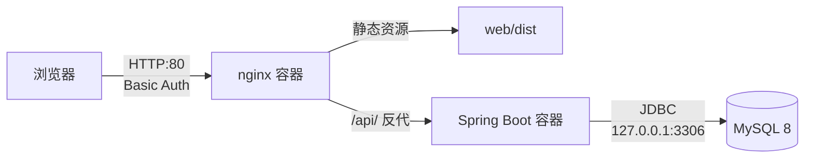

# DSA Log · 刷题记录

个人向的刷题记录与复习管理系统。单用户、无登录，把「刷过哪些题、当时怎么想的、什么时候该再看一遍」串成一条闭环。

不做题库镜像，只做**自己的**记录：一道题一个标题、一条外链、一段自己的思路，加上基于间隔重复的复习排期。

---

## 功能

### 题库

- 只存题名、难度、标签、外链与个人笔记，**不存题干原文**（版权与体积都不划算）
- 关键词 / 难度 / 状态 / 标签多条件组合筛选，标签之间是 **AND** 交集
- 8 种排序：更新时间、创建时间、标题、难度、已刷时间，各支持升降序
- 批量操作：标记已刷 / 取消已刷 / 打标签 / 加入题单 / 删除
- 归档：归档题不参与随机、待复习、统计、标签计数与题单进度

### 复习排期

间隔重复，四档阶梯：

```
新标记已刷 ──1天──> 3天 ──> 7天 ──> 15天 ──> 15天（封顶）
```

三档评分决定走向：

| 评分 | 效果 |
| --- | --- |
| `again` 忘了 | 降回第一档，次日零点再来 |
| `hard` 勉强 | 间隔减半 |
| `good` 顺利 | 进入下一档 |

待复习队列按到期时间升序，页面上标出逾期天数。**判据是 `next_review_at <= now`，不按自然日**——按自然日会让「早上到期」和「晚上到期」在下午时一个可见一个不可见。

### 随机一题

四级级联，保证「一轮内不重复」的体感：

```
未刷 ∩ 未抽过  →  未刷全部（重置）  →  全库 ∩ 未抽过  →  全库全部（重置）
```

已抽记录只存内存，刷新即重置。

### 题单

自定义颜色与排序，进度（已刷 / 总数）**实时现算不缓存**，保证与题库列表的数字永远一致。

### 备份

- 全量 JSON 导出 / 导入，两种模式：`merge`（按 `updatedAt` 取新）与 `replace`（整库还原，需二次确认）
- CSV 导出（带 BOM，Excel 直接打开不乱码）
- 服务器每日 `mysqldump`，保留 14 天

---

## 技术栈

| 层 | 选型 |
| --- | --- |
| 前端 | Vue 3.5 / Vite 7 / TypeScript（strict）/ Pinia 3 / Tailwind CSS v4 / Vue Router 4（hash）/ Dexie 4 |
| 后端 | JDK 17 / Spring Boot 4.1.1 / MyBatis-Plus 3.5.17 / MySQL 8 / HikariCP |
| 测试 | Vitest + fake-indexeddb（前端）/ JUnit 5 + Mockito（后端） |
| 部署 | Docker Compose（api + nginx）/ nginx 反代 + Basic Auth |

---

## 架构



### 数据源双轨

前端有一个**组合根** `web/src/repositories/index.ts`，按环境变量 `VITE_DATA_SOURCE` 注入不同实现：

```
                    ┌── local → Dexie（IndexedDB，纯前端跑）
repository 接口 ────┤
                    └── http  → Spring Boot + MySQL
```

两套实现**签名完全一致**，视图层与 store 只依赖 `types/repository.ts` 里定义的接口，不知道数据从哪来。

好处不只是「能离线跑」：本地开发不用起后端，而生产走真数据库；同一份业务逻辑被两套实现各跑一遍，**本身就是一种对拍测试**。

### 后端分层

```
Controller → Service（接口） → ServiceImpl（实现）→ Mapper（MyBatis-Plus）→ MySQL
                                      ↕
                                  Converter（实体 → VO）
```

- `@Transactional` 只写在实现方法上，接口上不出现
- 返回体统一 `Result<T> { code, message, data, traceId }`，`code` 全站 UPPER_SNAKE
- 时间在 Converter 里统一转 epoch 毫秒，VO 里不出现 `LocalDateTime`

---

## 目录结构

```
.
├── PLAN.md                       计划、DDL、API 契约、里程碑记录
├── web/                          前端
│   ├── src/
│   │   ├── api/                  HTTP client 与端点清单
│   │   ├── repositories/         仓储层
│   │   │   ├── dexie/            IndexedDB 实现
│   │   │   ├── http/             HTTP 实现
│   │   │   └── index.ts          组合根（按环境变量注入）
│   │   ├── services/             纯函数（复习算法、随机抽取、备份序列化）
│   │   ├── stores/               Pinia
│   │   ├── views/                页面
│   │   └── types/                模型与仓储接口
│   └── tests/                    Vitest
├── dsa-log-server/               后端
│   └── src/main/
│       ├── java/com/baimo/dsalogserver/
│       │   ├── controller/       7 个控制器，35 个端点
│       │   ├── service/ + impl/
│       │   ├── mapper/           MyBatis-Plus Mapper
│       │   ├── entity/ dto/ vo/
│       │   ├── converter/
│       │   └── common/           Result、ErrorCode、TimeUtil
│       └── resources/
│           ├── application.yml          开发配置
│           ├── application-prod.yml     生产覆盖
│           ├── db/schema.sql            DDL（7 张表）+ 初始化数据
│           └── mapper/*.xml             手写 SQL
└── deploy/                       Dockerfile、compose、nginx、备份与发版脚本
```

---

## 快速开始

### 只跑前端（推荐先这样体验）

```bash
cd web
npm install
npm run dev          # http://localhost:5173
```

数据存在浏览器 IndexedDB 里，**不需要后端和数据库**。

### 全栈本地开发

前置：JDK 17、Node 20+、MySQL 8。

```bash
# 1. 建库建表
mysql -uroot -p < dsa-log-server/src/main/resources/db/schema.sql

# 2. 起后端（数据库口令通过环境变量传入）
cd dsa-log-server
DB_PASSWORD=你的口令 ./mvnw spring-boot:run

# 3. 起前端，切到 HTTP 数据源
cd ../web
npm run dev:http     # 读取 .env.http，/api 走 vite 代理到 8080
```

### 关键环境变量

| 变量 | 作用 | 默认 |
| --- | --- | --- |
| `VITE_DATA_SOURCE` | `local` = IndexedDB，`http` = 后端接口 | `local`（dev）/ `http`（prod） |
| `VITE_API_BASE` | 接口前缀 | `/api` |
| `DB_HOST` / `DB_NAME` | 数据库地址与库名 | `127.0.0.1` / `dsa_log` |
| `DB_USER` / `DB_PASSWORD` | 数据库账号 | `root` / `123456`（仅本地开发） |

> `.env.production` 里是 `VITE_DATA_SOURCE=http`，所以生产构建出来就是走数据库的版本。

---

## 测试

```bash
# 前端：124 个用例
cd web && npm test

# 后端：单元测试
cd dsa-log-server && ./mvnw -o test

# 双跑对拍：同一组操作在 Dexie 与 HTTP 两套实现上各跑一遍，比语义指标
# 需要后端在 8080，且前后各做一次整库导出/还原
cd web && npm run test:parity
```

对拍测试是这套双轨设计的验收手段：以 `title` 为稳定键比较，避免 id 生成方式与时间戳毫秒差异造成的假失败。开发过程中它抓出过几个只靠人工点页面发现不了的问题（详见 `PLAN.md`）。

---

## 部署

产物在 `deploy/`，完整步骤见 [`deploy/RUNBOOK.md`](deploy/RUNBOOK.md)。

```bash
# 一条命令：本机构建 → 上传 → 建库 → 重建容器 → 健康检查
deploy/deploy.sh root@你的服务器
```

设计取向：

- **服务器不编译**。2G 内存跑 `mvn package` 极易 OOM，还会挤掉 MySQL。Dockerfile 只 `COPY app.jar`。
- **两个容器都走 `network_mode: host`**。后端只绑 `127.0.0.1:8080`，nginx 要反代它；走 bridge 时容器内的回环是它自己的，反代必然 502。
- **容器限额**。`mem_limit` + json-file `max-size`，单机 Docker 最常见的事故就是日志写满盘。
- **回滚靠镜像 tag**，`rollback.sh` 秒级完成。

---

## 几个设计取舍

记在这里，因为每一条都是踩过之后才定下来的。

**题目不存题干原文。** 只存标题 + 外链。题干是别人的内容，存进来既有版权问题，也让数据库体积翻几十倍，而翻看原文的需求用一个链接就能满足。

**前端用 hash 路由。** `/#/problems` 这种形式不需要服务端配 `try_files` 之外的任何东西，静态托管零配置。代价是 URL 不好看，对个人工具完全可以接受。

**时间统一用 epoch 毫秒。** 不用 ISO 字符串，避免时区解析歧义。后端在 Converter 层统一 `LocalDateTime → Long`，VO 里不出现时间类型。

**批量写用显式 SQL，不用 `updateById`。** MyBatis-Plus 默认的 `FieldStrategy.NOT_NULL` 会把 null 字段排除出 `SET` 子句，导致「置空」静默失效——批量取消已刷时的 `next_review_at = NULL` 正好撞上这个坑。另外逐条往返在几百条的量级上也太慢。

**`replace` 导入必须物理删。** 逻辑删会留下 `deleted = 1` 的行继续占主键，之后同 id 插不进去，表现为「导入成功但少数据」。

**初始化数据用 `INSERT IGNORE`。** 表格结构用 `CREATE TABLE IF NOT EXISTS` 是显然的，但初始化配置容易写成 `ON DUPLICATE KEY UPDATE` —— 而部署脚本每次发版都会跑一遍 DDL，结果就是用户改过的设置被静默重置回默认。

**统计口径只有一份。** 「今日已刷」按题目去重（`COUNT DISTINCT`），「今日复习」按流水条数计——前者衡量进度，后者衡量工作量，不合并成一个数字。

---

## 状态

功能开发完成，已部署在个人服务器上日常使用。

| 项目 | 数量 |
| --- | --- |
| 接口 | 35 个 |
| 数据表 | 7 张 |
| 前端测试 | 124 个 |
| 后端测试 | 86 个 |
| Java 源文件 | 86 个 |

已知未做：多用户、题干存储、移动端适配优化、TLS（当前 Basic Auth 走 HTTP，密码明文传输，仅因访问源受限而未处理）。
